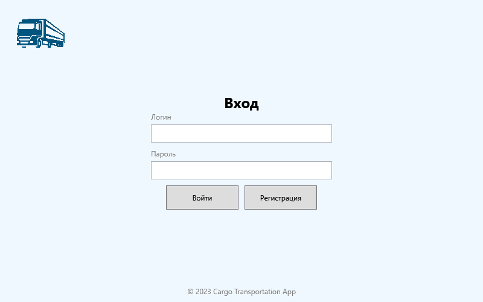
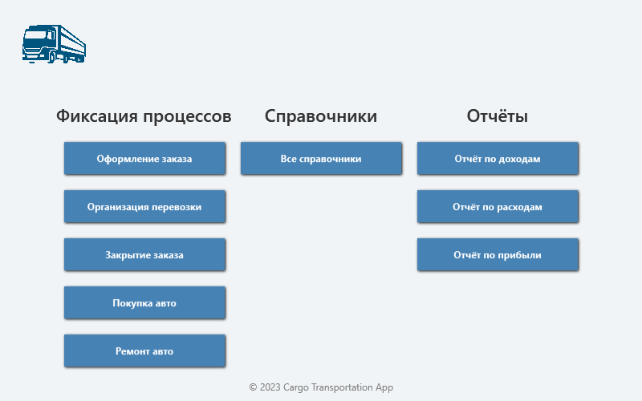
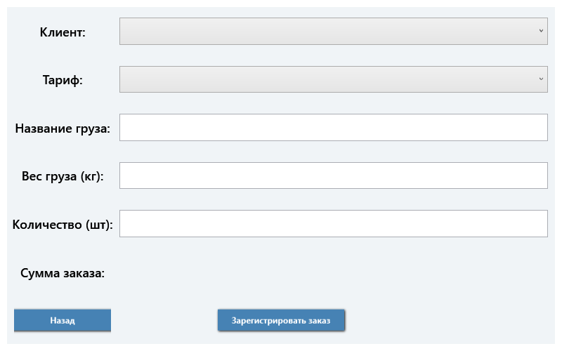
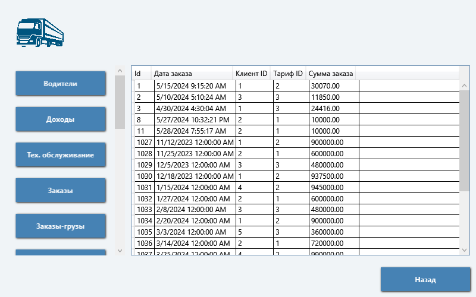
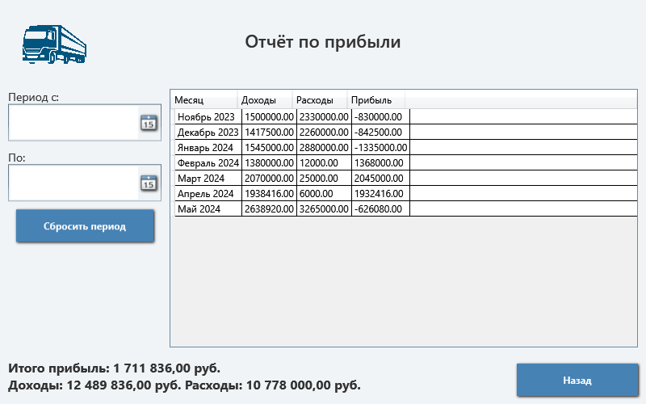
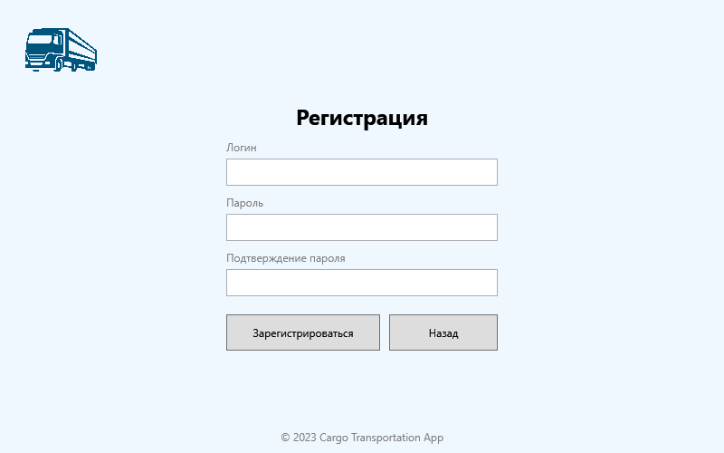

# Super Delivery — система учёта грузоперевозок


Десктопное приложение для автотранспортной компании: ведёт заказы, перевозки, автопарк и финансы. Учебный проект, доработанный для портфолио.

## Возможности

- **Авторизация и регистрация** — две роли: администратор (полный доступ) и сотрудник (справочники только на чтение)
- **Оформление заказа** — выбор клиента и тарифа, автоматический расчёт стоимости по весу и количеству груза
- **Организация перевозки** — назначение свободной машины, водителя и маршрута, расчёт предполагаемого времени доставки
- **Закрытие заказа** — фиксация оплаты, сверка с суммой заказа
- **Автопарк** — регистрация закупки машин и журнал техобслуживания
- **Справочники** — просмотр и редактирование всех 17 таблиц базы из одного окна
- **Отчёты** — доходы, расходы и прибыль по месяцам с фильтром по периоду

## Скриншоты

| Вход | Главное меню |
|---|---|
|  |  |

| Оформление заказа | Справочники |
|---|---|
|  |  |

| Отчёт по прибыли | Регистрация |
|---|---|
|  |  |

## Стек

- C#, WPF
- .NET Framework 4.7.2
- Entity Framework 6 (Database First)
- MS SQL Server

## Структура

```
cargo_traffic/
├── MainWindow          — окно с фреймом навигации
├── LoginPage           — вход
├── RegistrationPage    — регистрация (роль «сотрудник»)
├── MainPage            — главное меню
├── MakeOrderPage       — оформление заказа
├── TransportationPage  — организация перевозки
├── ClosingOrderPage    — закрытие заказа
├── TrucksPurchasePage  — закупка машин
├── RepairPage          — техобслуживание
├── DBRedactPage        — справочники
├── ReportsPage         — отчёты (доходы/расходы/прибыль)
└── Model1.edmx         — модель БД (EF6, Database First)
```

## Запуск

1. Открыть `cargo_traffic.sln` в Visual Studio 2022
2. Развернуть базу `cargo_traffic_v4` в SQL Server и поправить `connectionString` в `App.config` под свой сервер
3. Собрать и запустить (F5)

Учётная запись администратора создаётся в таблице `пользователи` вручную, дальше сотрудники регистрируются через приложение.
